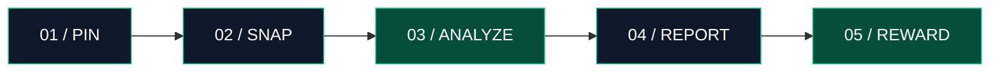
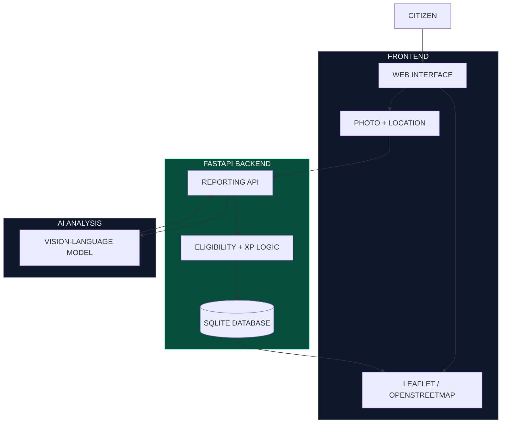

 <div align="center">

# ♿ Manext

### THE CITY SHOULD WORK FOR EVERYONE.

**One photo can reveal a barrier.  
One report can make it visible.  
Thousands of reports could help reshape a city.**

<br>

[](https://python.org)
[](https://fastapi.tiangolo.com)
[](https://developer.mozilla.org/en-US/docs/Web/JavaScript)
[](https://leafletjs.com)
[](https://sqlite.org)

<br>

`AI-ASSISTED` · `MAP-FIRST` · `COMMUNITY-POWERED`

**From invisible obstacles to actionable information.**

---

</div>

## THE PROBLEM ISN'T ALWAYS THE ROAD.

### Sometimes, it's not knowing what's ahead.

Imagine arriving at a building only to discover stairs without a visible accessible alternative.

Or finding that the wheelchair ramp you planned to use is blocked.

For many people with mobility limitations, these are not minor inconveniences. They can determine whether a destination is reachable at all.

And when accessibility information is missing, people are left to discover barriers themselves.

**We believe that should change.**

---

## INTRODUCING ACCESSPATH.

### Your city. Your voice. A clearer path forward.

AccessPath is an AI-assisted urban accessibility reporting platform that helps communities identify and map physical barriers.

No complicated reporting forms.

No manual categorization.

Just **a location, a photo, and a system designed to turn observations into useful accessibility information.**

<div align="center">

### `SPOT IT → SNAP IT → MAP IT`

</div>

---

## THE EXPERIENCE

### Reporting a barrier should take seconds, not paperwork.



**01 — Choose your location**

Use GPS, select a point on the map, or enter coordinates.

**02 — Upload one photo**

Capture a potential barrier: stairs, a blocked ramp, an inaccessible entrance, or a damaged sidewalk.

**03 — Let AI assist**

Computer Vision evaluates visible evidence and determines whether the photo appears to show a relevant accessibility barrier.

**04 — Put the problem on the map**

Reports become part of a location-based accessibility information system.

**05 — Make participation rewarding**

Eligible AI-reviewed reports can earn **+10 provisional XP**, encouraging citizens to contribute.

---

## NOT JUST ANOTHER MAP.

### A reporting experience designed around real-world accessibility.

| | Capability | Why it matters |
|---|---|---|
| 01 | **AI-Assisted Reporting** | Reduces the need for manual descriptions and categories |
| 02 | **Location Intelligence** | Connects observations to specific places |
| 03 | **Visual Evidence** | Gives reports supporting image context |
| 04 | **Community Incentives** | Encourages participation through provisional XP |
| 05 | **Review-Aware Workflow** | Keeps uncertain AI results from being treated as confirmed |
| 06 | **Complaint Drafting** | Helps turn observations into structured reports for official channels |

### Less friction for citizens. More structured information for action.

---

## THE ENGINEERING BEHIND THE EXPERIENCE.

We designed AccessPath as a lightweight, map-first MVP with a clear separation between the interface, API, AI analysis, and data storage.



### Built with purpose.

**FastAPI** — Lightweight Python API architecture.

**Leaflet + OpenStreetMap** — Interactive geospatial visualization.

**Vision-language AI** — Image understanding for potential barrier identification.

**SQLite** — Simple persistence suited to a hackathon prototype.

**Vanilla JavaScript** — A focused frontend without unnecessary framework overhead.

**Rule-based eligibility** — XP decisions remain separate from the AI's visual description.

---

## A LOOK INSIDE.

### Product demo

*Add a real screenshot or GIF of AccessPath here.*

**Suggested visual sequence:**

`MAP VIEW` → `LOCATION PIN` → `PHOTO UPLOAD` → `AI RESULT` → `+10 XP`

> [!TIP]
> A short demo GIF is the fastest way to show visitors how AccessPath works.

---

## BUILT FOR BAKU. DESIGNED WITH A BIGGER VISION.

Our first prototype focuses on **Baku, Azerbaijan**.

But inaccessible infrastructure is not unique to one city.

We envision a future where communities can contribute accessibility observations, discover reported barriers, and help make urban infrastructure more inclusive.

### Local starting point. Global relevance.

---

## GET IT RUNNING.

<details>
<summary><b>01 / SETUP THE PROJECT</b></summary>

Clone:

```bash
git clone https://github.com/YOUR_USERNAME/AccessPath.git
cd AccessPath/backend
python -m venv .venv
```

Install dependencies in Windows PowerShell:

```powershell
.\.venv\Scripts\python.exe -m pip install -r requirements.txt
```

</details>

<details>
<summary><b>02 / CONFIGURE AI</b></summary>

Configure the AI provider implemented by your backend.

For Gemini:

```powershell
$env:GEMINI_API_KEY="YOUR_API_KEY"
```

For OpenAI:

```powershell
$env:OPENAI_API_KEY="YOUR_API_KEY"
```

The application must include the corresponding provider integration. Environment variables alone do not switch providers.

Never commit real API keys.

</details>

<details>
<summary><b>03 / START THE SERVER</b></summary>

From the backend directory:

```powershell
.\.venv\Scripts\python.exe -m uvicorn main:app --reload --port 8000
```

**Application:** http://127.0.0.1:8000

**API Docs:** http://127.0.0.1:8000/docs

</details>

---

## WHAT'S NEXT?

Our MVP is the foundation for a larger accessibility intelligence system.

- [ ] Complete and validate AI provider integration
- [ ] Test end-to-end reward eligibility
- [ ] Community-based report verification
- [ ] Accessible route recommendations
- [ ] Offline-first reporting
- [ ] City-level accessibility insights
- [ ] Integration with official reporting services

These are development goals, not claims of completed functionality.

---

## BUILT WITH RESPONSIBILITY.

> [!IMPORTANT]
> AI is an assistant, not an accessibility inspector.

A photo cannot independently prove a barrier's location, date, or authenticity. AI assessments may be incorrect, and XP rewards are provisional.

AccessPath does not automatically submit complaints to government systems. Official reporting requires user action.

Demo scenarios are illustrative and should not be mistaken for verified accessibility incidents.

---

<div align="center">

## WE CAN'T FIX WHAT WE CAN'T SEE.

### Let's make accessibility visible.

**ACCESSPATH**

`BUILT FOR PEOPLE. POWERED BY COMMUNITY. ASSISTED BY AI.`

<br>

**Because getting somewhere shouldn't be the hardest part.**

</div>

## with team Lumora

- Aysel Musayeva
- Nurana Aliyeva
- Fatima Malikova
- Sevil Babayeva
- Namig Mammadzada

</div>
